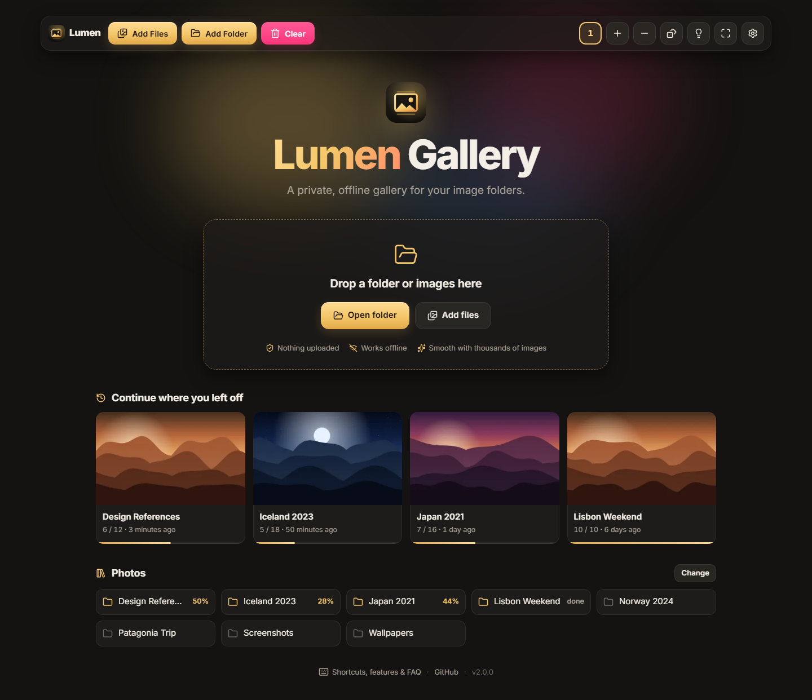
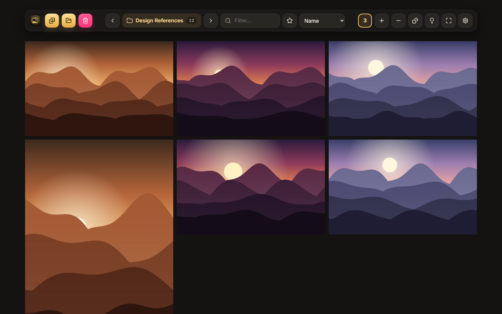
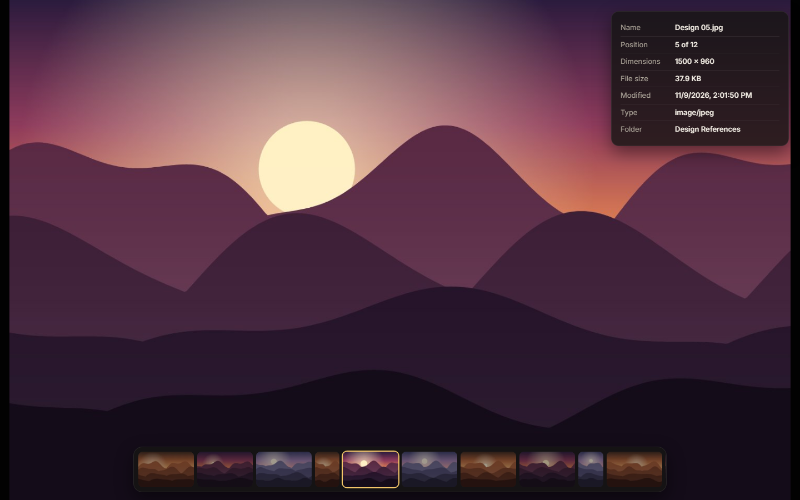
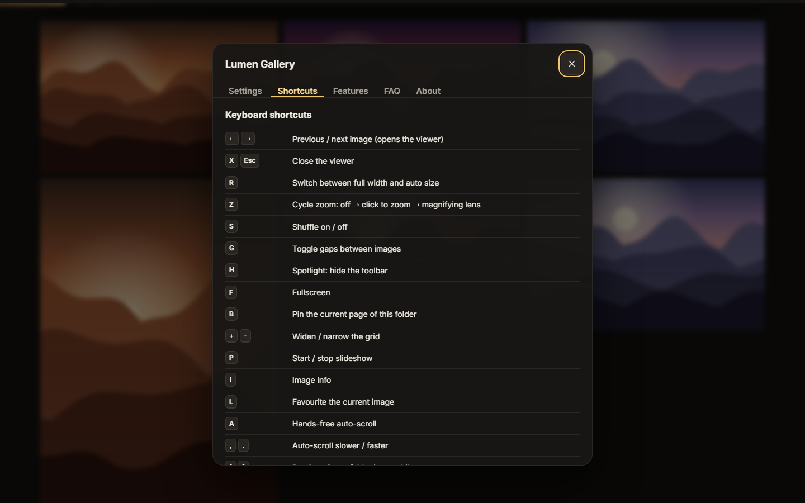

<div align="center">


# Lumen Gallery: A Private, Offline Image & Video Folder Viewer

**Open a whole folder of images, GIFs and videos and browse it in a fast, private gallery that runs in your browser.**
Reopen recent folders in one click and pick up exactly where you stopped.

[](https://abduldevhub.github.io/Lumen-Gallery/)
[](https://github.com/AbdulDevHub/Lumen-Gallery/releases/latest)

[](https://github.com/AbdulDevHub/Lumen-Gallery/releases)
[](LICENSE)




</div>

## Project Overview

Lumen Gallery is an image viewer for people who keep pictures in folders on their computer. You point it at a folder and it shows everything inside as a grid you can scroll, zoom and flip through. It never uploads anything: the browser reads the files straight from your disk.

It started as a Chrome extension I built for myself. Version 2 adds two things I kept wishing for. First, it remembers the folders you open, so getting back to one is a single click and it offers to resume at the image where you stopped. Second, it stays smooth with folders of thousands of images. Images far off-screen are released from memory, every tile is sized from the file header before it loads, and GIFs only animate when you hover them, so a wall of GIFs no longer slows the computer down.

The same files ship two ways. GitHub Pages serves them as a website you can install as an offline app, and the same code is packaged as a Chrome extension. There's no build step and no runtime dependencies, just HTML, CSS and JavaScript modules.

## Features

| | |
| --- | --- |
| **Recent folders** | Reopen any folder you've viewed in one click. Cards show a thumbnail, how far you got and when you last opened it. |
| **Resume where you left off** | Your position is saved as you scroll. When you reopen a folder you get a *Resume at 37* button. <kbd>B</kbd> pins a page on purpose. |
| **Library** | Point it at a parent folder to see every sub-folder with its progress, then jump between neighbouring folders with <kbd>[</kbd> and <kbd>]</kbd>. |
| **Built for huge folders** | Thousands of images load in seconds and scroll smoothly. Memory stays flat, and jumping to image 3,000 lands exactly. |
| **Calm GIFs** | GIFs show a still frame in the grid and play on hover or in the viewer. You can change this in Settings. |
| **Flexible grid** | 1, 2, 3, 6, 12 or 24 images per row, adjustable width, gaps on/off, and natural or fill width. Your layout is remembered. |
| **Focused viewer** | Auto sizing for tall and panoramic images, click-to-zoom, a magnifying lens, a thumbnail strip, an image info panel and swipe gestures. |
| **Hands-free** | A slideshow with adjustable speed, and smooth auto-scroll (<kbd>A</kbd>) for long folders. |
| **Organise as you browse** | Favourites (<kbd>L</kbd>), filter by file name (<kbd>/</kbd>), sort by name, date or size, or shuffle. |
| **Videos** | Videos become evenly spaced preview frames that you can browse like images. |
| **Private and offline** | No uploads, accounts or analytics. Works without a connection. |
| **Install anywhere** | Use it as a website, install it as an app (it can open images straight from your OS), or add the Chrome extension (<kbd>Alt</kbd>+<kbd>G</kbd>). |

## Screenshots

| Grid | Viewer |
| --- | --- |
|  |  |



## Get it

### Use the web app

Open **[abduldevhub.github.io/Lumen-Gallery](https://abduldevhub.github.io/Lumen-Gallery/)**. To install it as an offline app, click the install icon in Chrome or Edge's address bar.

### Install the Chrome extension

1. Download `lumen-gallery-extension.zip` from the [latest release](https://github.com/AbdulDevHub/Lumen-Gallery/releases/latest) and unzip it.
2. Open `chrome://extensions` and turn on **Developer mode** (top right).
3. Click **Load unpacked** and select the unzipped folder.

Open it from the toolbar icon or with <kbd>Alt</kbd>+<kbd>G</kbd>.

## Keyboard shortcuts

| Key | Action |
| --- | --- |
| <kbd>←</kbd> / <kbd>→</kbd> | Previous / next image (opens the viewer) |
| <kbd>X</kbd> or <kbd>Esc</kbd> | Close the viewer |
| <kbd>R</kbd> | Switch between full width and auto size |
| <kbd>Z</kbd> | Cycle zoom: off → click to zoom → magnifying lens |
| <kbd>S</kbd> | Shuffle on / off |
| <kbd>G</kbd> | Toggle gaps between images |
| <kbd>H</kbd> | Spotlight: hide the toolbar |
| <kbd>F</kbd> | Fullscreen |
| <kbd>B</kbd> | Pin the current page of this folder |
| <kbd>+</kbd> / <kbd>-</kbd> | Widen / narrow the grid |
| <kbd>P</kbd> | Slideshow |
| <kbd>I</kbd> | Image info |
| <kbd>L</kbd> | Favourite the current image |
| <kbd>A</kbd> | Auto-scroll (<kbd>,</kbd> / <kbd>.</kbd> slower / faster) |
| <kbd>[</kbd> / <kbd>]</kbd> | Previous / next folder in your Library |
| <kbd>/</kbd> | Filter by file name |
| <kbd>O</kbd> | Open a folder |
| <kbd>?</kbd> | Shortcuts, features and FAQ |

Move the mouse to the left edge to reveal the side controls, or to the bottom edge in the viewer to show the thumbnail strip.

## Privacy

Everything happens on your device. Files are read with standard browser APIs and never leave your computer. Recent folders, progress and favourites are stored in your browser's own storage (IndexedDB), and you can wipe them from **Settings → Forget recent folders & progress**.

## Browser support

Everything works in current Chrome, Edge, Firefox and Safari. **Recent folders** and the **Library** use the [File System Access API](https://developer.mozilla.org/docs/Web/API/File_System_API), which only Chromium browsers (Chrome, Edge, Opera, Brave) have. In other browsers you pick the folder each time, but your progress is still remembered.

## Development

No build step: the files in this repo *are* the app.

```sh
npm install
npx playwright install chromium   # once
npm run serve                     # http://localhost:4173/
npm test                          # generates test images, runs the Playwright suite
npm run package                   # dist/site (GitHub Pages) + dist/extension (zip)
npm run shots                     # regenerates screenshots + social images (generated art only)
```

Pushing to `main` deploys the site to GitHub Pages. Pushing a `v*` tag builds the extension zip and attaches it to a GitHub Release.

```txt
Lumen-Gallery
├── index.html            # the whole app (and the SEO/landing content)
├── src/                  # ES modules: grid, viewer, library, files, settings, …
├── styles/               # main, loader and effects CSS
├── icons/ assets/        # logo, icons, font, screenshots, OG image
├── manifest.json         # Chrome extension (MV3)
├── background.js         # opens the gallery from the toolbar / Alt+G
├── site.webmanifest sw.js robots.txt sitemap.xml 404.html   # web app only
├── tests/  tools/        # Playwright tests, fixture/screenshot/packaging scripts
└── .github/workflows/    # Pages deploy + release zip
```

## License

[MIT](LICENSE) © Abdul Hadi Khan. Includes the [Inter](https://rsms.me/inter/) typeface (SIL OFL) and [Lucide](https://lucide.dev) icons (ISC).
